# Drupal High-Availability Infrastructure on AWS

## 1. Project Overview

This project deploys a Drupal website on Amazon Web Services (AWS) using a highly available infrastructure architecture. It demonstrates infrastructure provisioning, application deployment, load balancing, automatic scaling, shared storage, database hosting, monitoring, and resilience testing.

**AWS Region:** Europe (London) — `eu-west-2`

## 2. Project Objectives

- Build a VPC with public and private subnets.
- Deploy Drupal application servers in private subnets.
- Configure an Application Load Balancer.
- Host the Drupal database using Amazon RDS for MySQL.
- Configure Amazon EFS for shared Drupal file storage.
- Implement Auto Scaling based on CPU utilization.
- Monitor infrastructure with Prometheus and Grafana.
- Validate application availability during instance termination.
- Perform load testing and document the results.

## 3. Architecture and Technologies

| Component | Purpose |
|---|---|
| AWS VPC | Isolated network environment |
| Public/private subnets | Network segmentation |
| Internet Gateway | Internet connectivity for public resources |
| NAT Gateway | Outbound connectivity for private resources |
| Application Load Balancer | Distributes incoming HTTP traffic |
| Amazon EC2 | Hosts Drupal application instances |
| Auto Scaling Group | Maintains application capacity |
| Amazon RDS MySQL | Relational database |
| Amazon EFS | Shared file storage |
| Terraform | Infrastructure as Code |
| Ansible | Configuration and validation |
| Docker Compose | Local application testing |
| Prometheus | Metrics collection |
| Grafana | Monitoring dashboards |
| GitHub Actions | CI/CD validation and deployment checks |

## 4. Implementation Steps

### Step 1: Prepare the AWS Environment

AWS CLI was used to inspect and manage resources in the London region.

```bash
aws sts get-caller-identity
aws ec2 describe-regions --region eu-west-2
```

### Step 2: Provision the Network Infrastructure

Terraform provisioned a VPC with CIDR `10.20.0.0/16`, public and private subnets, an Internet Gateway, a NAT Gateway, route tables, and security groups.

```bash
cd terraform
terraform init
terraform fmt
terraform validate
terraform plan
```

Screenshot: `screenshots/02-vpc-network-architecture.png`

### Step 3: Configure RDS and EFS

Amazon RDS for MySQL 8.0 was configured with a `db.t3.micro` instance, 20 GB gp3 storage, and Multi-AZ enabled.

Amazon EFS was configured as an encrypted Regional file system with mount targets in the private subnets.

Screenshots:

- `screenshots/03-rds-database.png`
- `screenshots/03-efs-storage.png`
- `screenshots/03-efs-mount-targets.png`

### Step 4: Deploy the Drupal Application

EC2 application instances were configured to run Drupal and Apache. Ansible was used to validate application prerequisites and availability.

```bash
ansible-playbook -i ansible/inventory.ini ansible/drupal.yml
```

Docker Compose was available for local testing.

```bash
docker compose config
docker compose up -d
docker compose ps
```

Screenshot: `screenshots/04-drupal-website.png`

### Step 5: Configure the Application Load Balancer

The Application Load Balancer `drupal-network-alb` routes HTTP requests to the registered application targets. The target group health check uses `/core/install.php`.

The endpoint was checked using:

```bash
curl -I http://drupal-network-alb-1901882455.eu-west-2.elb.amazonaws.com
```

Screenshots:

- `screenshots/05-load-balancer.png`
- `screenshots/05-target-group-health.png`

### Step 6: Configure Auto Scaling

The Auto Scaling Group `drupal-network-asg` was configured with a minimum of 2 instances, desired capacity of 2, maximum capacity of 4, and a CPU target tracking policy targeting 50%.

```bash
aws autoscaling describe-auto-scaling-groups \
  --region eu-west-2 \
  --auto-scaling-group-names drupal-network-asg \
  --query 'AutoScalingGroups[0].{Min:MinSize,Desired:DesiredCapacity,Max:MaxSize,Instances:Instances[*].[InstanceId,LifecycleState,HealthStatus]}' \
  --output json
```

The recorded baseline showed two instances in the `InService` state with `Healthy` health status.

Screenshot: `screenshots/06-autoscaling-baseline.png`

### Step 7: Configure Prometheus

Prometheus was deployed on a monitoring EC2 instance. Its configuration uses EC2 service discovery to identify Drupal instances and scrape Node Exporter metrics on port 9100.

Configuration file on the monitoring server:

`~/monitoring/prometheus/prometheus.yml`

The configuration includes a 15-second scrape interval and an EC2 discovery job filtered by the application instance tag.

Screenshot: `screenshots/07-prometheus-config.png`

### Step 8: Configure Grafana

Grafana was configured to use Prometheus as its data source. The Drupal dashboard contains panels for CPU, memory, disk, network receive, network transmit, and instance availability.

Dashboard file on the monitoring server:

`~/monitoring/grafana/dashboards/drupal-dashboard.json`

Screenshot: `screenshots/08-grafana-dashboard-overview.png`

### Step 9: Test Application Resilience

One EC2 instance was terminated through the Auto Scaling Group without reducing desired capacity.

```bash
aws autoscaling terminate-instance-in-auto-scaling-group \
  --region eu-west-2 \
  --instance-id i-0e31d4dec6ed419ba \
  --no-should-decrement-desired-capacity
```

During the test, 10 recorded requests to the load balancer returned HTTP 200. Auto Scaling launched a replacement instance and restored the group to two healthy instances.

Scaling activity was inspected with:

```bash
aws autoscaling describe-scaling-activities \
  --region eu-west-2 \
  --auto-scaling-group-name drupal-network-asg \
  --max-items 10 \
  --output table
```

Screenshots:

- `screenshots/09a-autoscaling-activity.png`
- `screenshots/09b-autoscaling-healthy-instances.png`

### Step 10: Perform Load Testing and Document Results

ApacheBench was used to generate concurrent requests through the load balancer.

```bash
ab -t 180 -c 20 \
  http://drupal-network-alb-1901882455.eu-west-2.elb.amazonaws.com/
```

Recorded results:

- Duration: approximately 180 seconds
- Concurrency: 20
- Completed requests: 12,017
- Throughput: approximately 66.75 requests per second
- One failed request and one non-2xx response were reported

CloudWatch CPU metrics showed average CPU utilization approaching 100% during the recorded high-load period, followed by a return to approximately 1% after the load ended.

```bash
aws cloudwatch get-metric-statistics \
  --region eu-west-2 \
  --namespace AWS/EC2 \
  --metric-name CPUUtilization \
  --dimensions Name=AutoScalingGroupName,Value=drupal-network-asg \
  --start-time "2026-10-27T07:45:00Z" \
  --end-time "2026-10-27T09:15:00Z" \
  --period 300 \
  --statistics Average Maximum \
  --query 'sort_by(Datapoints,&Timestamp)[].[Timestamp,Average,Maximum]' \
  --output table
```

Screenshots:

- `screenshots/10-cpu-load-test.png`
- `screenshots/10-autoscaling-capacity.png`

The Auto Scaling Group was subsequently observed at its baseline capacity of two healthy instances. Although the group had previously reached four instances, the recorded activities do not establish that the specific CPU stress test caused that scale-out.

## 5. Results Summary

| Test or component | Recorded result |
|---|---|
| Drupal website | Loaded through the Application Load Balancer |
| RDS | MySQL 8.0 with Multi-AZ enabled |
| EFS | Encrypted Regional file system |
| Auto Scaling | Minimum 2, maximum 4 instances |
| Resilience test | 10 HTTP 200 responses during instance termination |
| Load test | 12,017 completed requests |
| CPU monitoring | CPU approached 100% during the recorded load period |
| Monitoring | Prometheus configuration and Grafana dashboard captured |

## 6. Security Considerations

- Keep AWS credentials and database passwords out of Git.
- Restrict security groups to required sources and ports.
- Use private subnets for application and database resources.
- Apply least-privilege IAM policies.
- Use encryption for storage.
- Configure HTTPS before using the application in production.
- Review backup and recovery requirements before production deployment.

## 7. Future Improvements

- Configure HTTPS using AWS Certificate Manager.
- Investigate failed and non-2xx load-test responses.
- Verify that every Grafana panel displays live metrics.
- Repeat controlled scaling tests and correlate CPU metrics with scaling activities.
- Configure and test alert notifications.
- Review AWS costs and remove resources when the assignment is complete.

## 8. Conclusion

This project demonstrates a Drupal deployment on AWS using Terraform, Ansible, an Application Load Balancer, Auto Scaling, RDS, EFS, Prometheus, and Grafana.

The recorded resilience test showed that the website continued responding while an application instance was terminated and replaced. Load testing and CloudWatch metrics provided evidence of CPU behavior under sustained traffic.

## 9. Screenshots and Evidence

All project screenshots are stored in the `screenshots/` directory. They document the AWS instances, network architecture, database, shared storage, Drupal website, load balancer, target health, Auto Scaling, Prometheus configuration, Grafana dashboard, resilience test, and CPU load test.

## Screenshot Gallery

The following screenshots document the AWS infrastructure,
Drupal deployment, monitoring dashboards, and resilience tests.

### Aws Instances

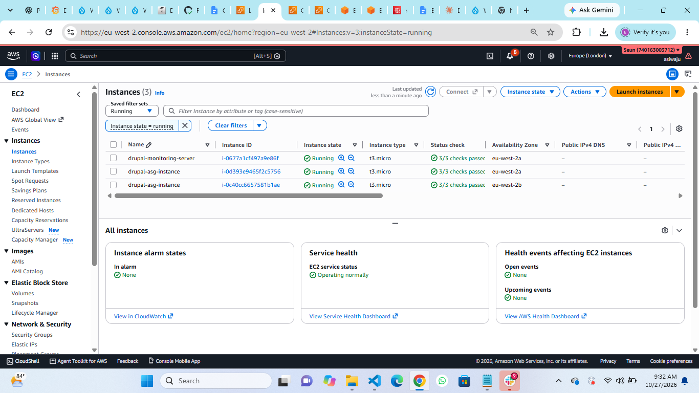

### Vpc Network Architecture

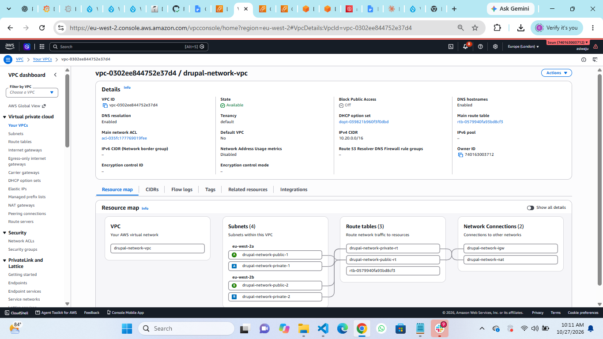

### Efs Mount Targets

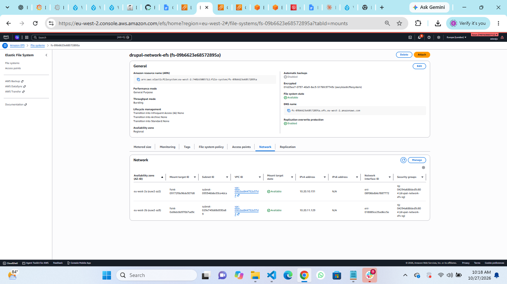

### Efs Storage

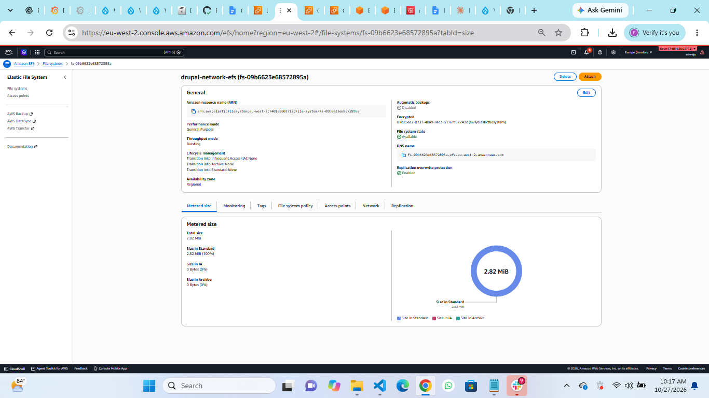

### Rds Database

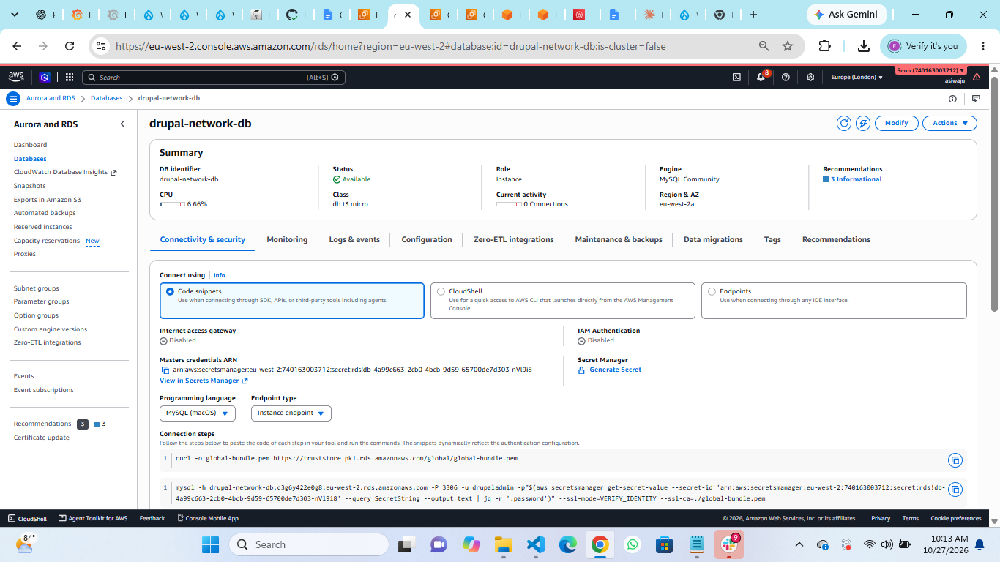

### Drupal Website

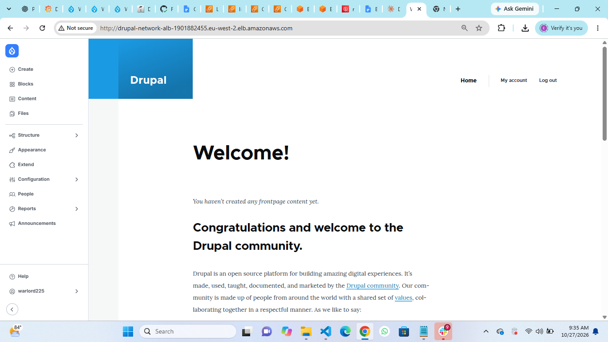

### Load Balancer

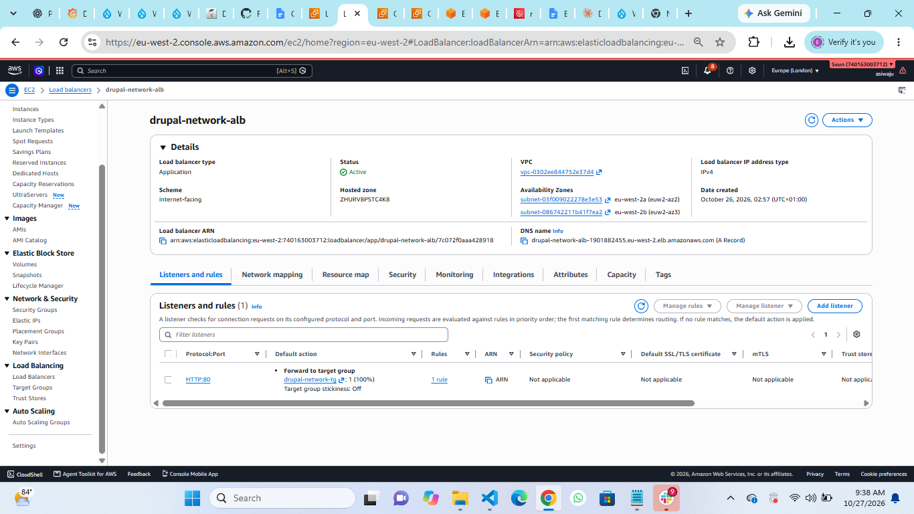

### Target Group Health

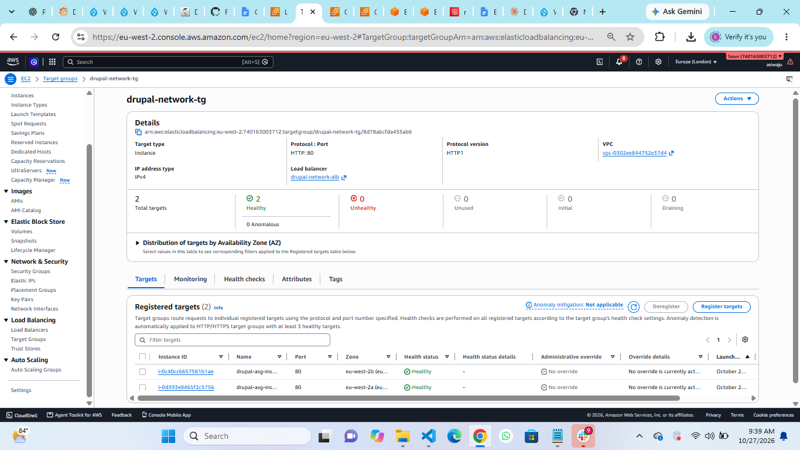

### Autoscaling Baseline

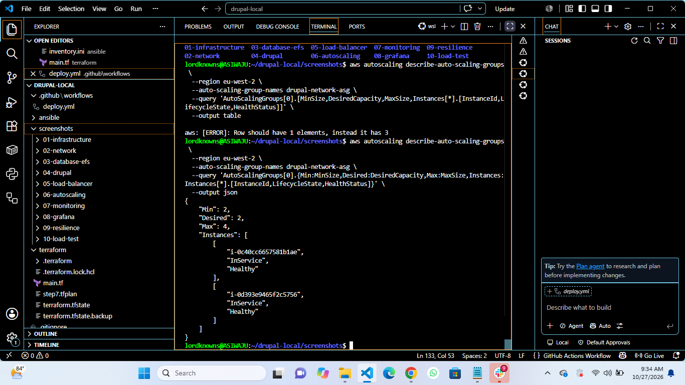

### Prometheus Config

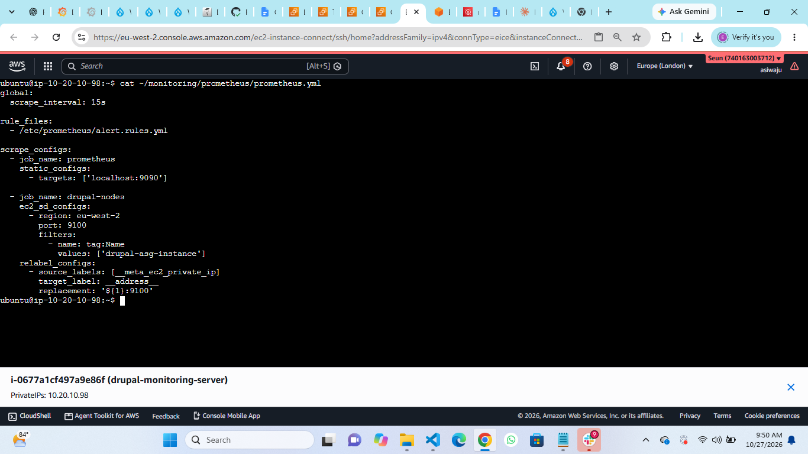

### Grafana Dashboard Overview

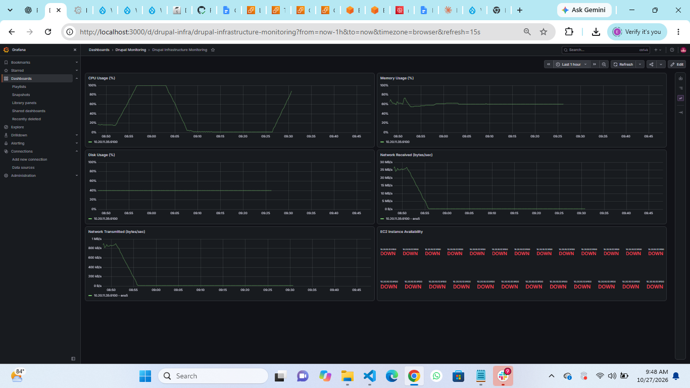

### Autoscaling Activity

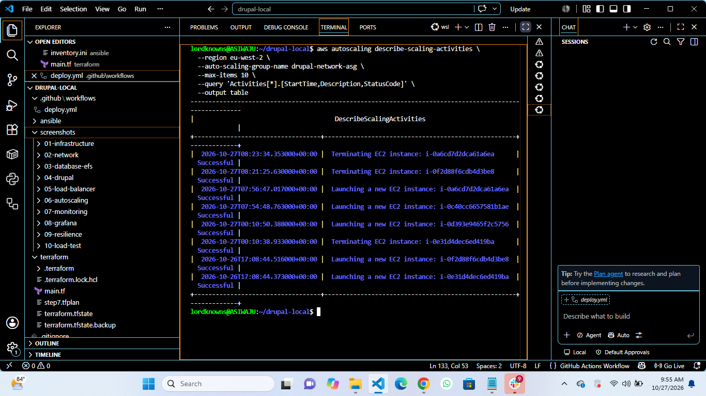

### Autoscaling Healthy Instances

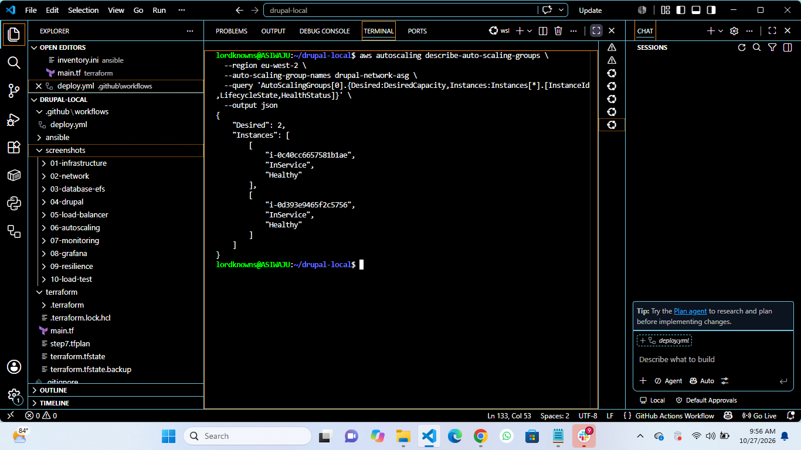

### Autoscaling Capacity

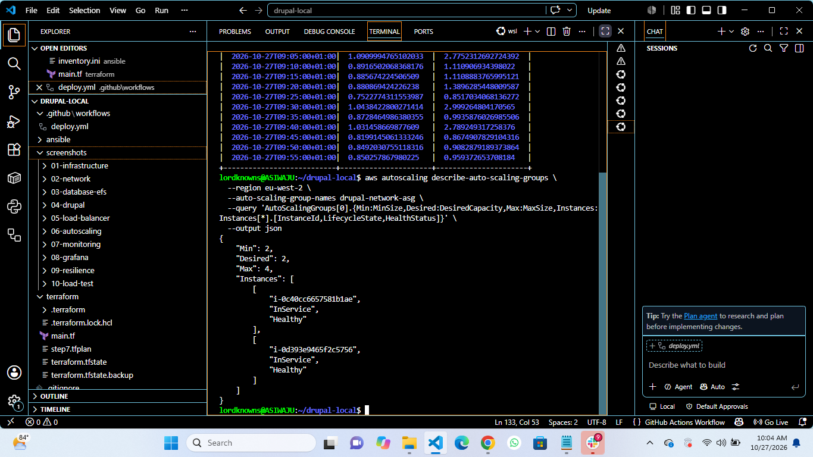

### Cpu Load Test

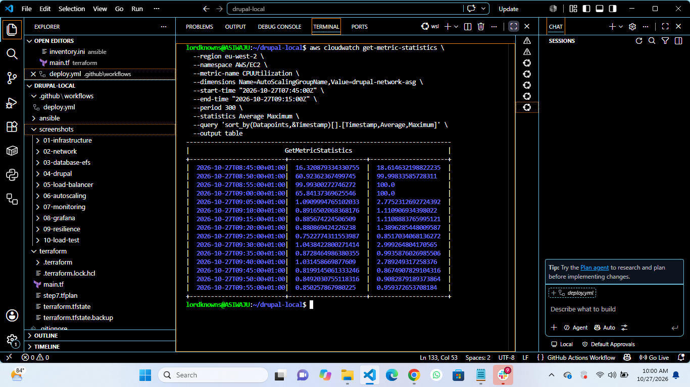

## CI/CD Pipeline — GitHub Actions

The project includes a GitHub Actions workflow defined in
`.github/workflows/deploy.yml` to automate CI/CD validation and deployment checks.

The workflow is maintained in the repository and can be reviewed under the
**Actions** tab on GitHub. Workflow results help verify whether the configured
jobs complete successfully.

### CI/CD Workflow Evidence

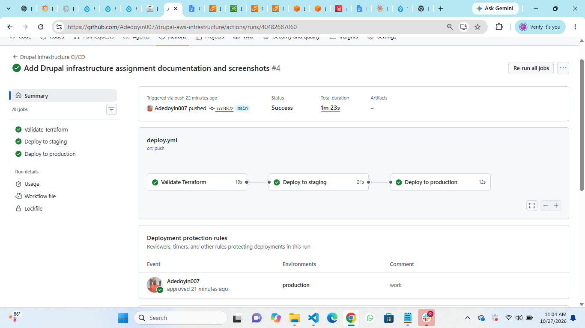

